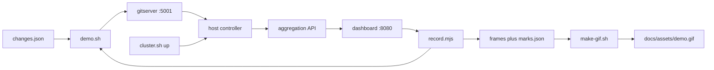

# Record the dashboard demo GIF

The GIF shows the Promotion Explorer: the promotion map of a diamond-shaped strategy (development fans out to `staging-us` and `staging-eu`, which both feed production), one change flowing through that graph while production waits for the slower staging soak, and the details panel for the production deployment. Scripts live in `.agents/skills/record-ui-demo-gif/scripts/`. Run commands below from the repo root. `$S` is that directory:

```bash
S=.agents/skills/record-ui-demo-gif/scripts
```

```
scripts/
  cluster.sh      up | down [--all]
  demo.sh         seed | promote <n> [--wait] | reset
  changes.json    the four scripted commits (shared by demo.sh and record.mjs)
  gitserver/      gitkit on 127.0.0.1:5001
  manifests/demo.yaml
  record.mjs      Playwright storyboard; lossless frames + marks.json
  make-gif.sh     ffmpeg time-lapse, scale, palette -> docs/assets/demo.gif
```

## Architecture



`demo.sh` plays the Argo CD source hydrator: it pushes `hydrator.metadata` (dry commit plus `references[].commit`, which is the app commit on screen) and a short per-environment manifest to `environment/<env>` and `environment/<env>-next` on the local git server. `DEMO_ENVS` in `demo.sh` must list the same environments as `manifests/demo.yaml`. The host controller, using the built-in fake SCM provider, opens and merges the pull requests. The dashboard reads the aggregated view API.

`record.mjs` drives the page and writes PNG frames, `frames.txt`, and `marks.json`. Each mark has a `maxDuration`; `make-gif.sh` plays longer segments as a time-lapse (`GIF_TIMELAPSE_FPS`) and leaves shorter ones in real time.

Change 0 in `changes.json` is the baseline `seed` deploys everywhere. Change 1 is promoted before recording so the Explorer has older rows under the new one. Change 2 is the take (`record.mjs` runs `demo.sh promote 2` itself). Change 3 is a spare.

## Invariants

These look removable and are not:

- The controller runs on the host, not in Tilt or the cluster. The fake SCM provider clones `http://localhost:5001/<owner>/<name>`. `cluster.sh up` scales an in-cluster `promoter-controller-manager` to 0; `down` restores the replica count.
- Requeue is 3s. The fake provider posts its webhook to port 3334, which nothing serves outside tests, so merges are noticed only on requeue.
- The strategy is a diamond through `dependsOn`, gated by the `DependentsSuccessfulCommitStatus`. Both staging regions merge together once development's soak passes. `TimedCommitStatus` soaks 12s in development, `staging-us`, and production, and 24s in `staging-eu`, so production visibly waits for the slower branch. Equal soaks would hide the fan-in.
- The Argo CD `Application` CRD must exist or the controller exits at startup. `cluster.sh up` installs it from `test/external_crds/` when the cluster has none.
- Frames are lossless CDP PNGs, and the browser context sets `reducedMotion: 'reduce'`. Playwright's webm recording made the GIF about ten times larger. The viewport is 1800x1000 at CSS zoom 1.1 (about 1640 CSS px) because the Explorer matrix needs about 1600 CSS px for the commit column plus four environment columns. At zoom 1.15 the production column is clipped. The fake cursor's own zoom is `1/zoom` so it tracks the pointer.
- `marks.json` `maxDuration` is what turns controller waits into time-lapse. Clicks and the details panel stay real time.
- `record.mjs` finds the new change's row by its dry commit subject and reads each environment's cell by column index, in `spec.environments` order. It waits on `.cell__pill--live`. Renaming those classes in `FlowCell` breaks the recorder.
- `demo.sh reset` deletes the namespace while the controller is running, so the controller drops finalizers. `cluster.sh down` strips them itself, because the host processes are already stopped.

## Prerequisites

- A local Kubernetes context you can install CRDs into (`kind create cluster` is enough). `go`, `node` (>= 20; CI uses 24.22.1), `kubectl`, `ffmpeg`, `jq`, `openssl`. `gifsicle` is optional.
- Ports 5001 (git), 8080 (dashboard), and 3333/9080/9081 (controller) free.

## Procedure

Each long-lived process gets its own terminal. In agent sessions, start them as background shells and check their logs before continuing.

1. `$S/cluster.sh up` — CRDs, `promoter-system` ControllerConfiguration with 3s requeue, aggregation apiserver, APIService Available. Idempotent.
2. `go run ./$S/gitserver`
3. `PATH="$PWD/hack/git:$PATH" go run ./cmd controller --namespace promoter-system` (add `--context <ctx>` if needed). Errors from unrelated namespaces are harmless.
4. `make build-dashboard && go run ./cmd dashboard --port 8080` so the GIF matches the current tree. `build-dashboard-ui` alone fails on a fresh checkout because `ui/components-lib` dependencies are not installed.
5. `$S/demo.sh seed`, then `kubectl -n promoter-demo get promotionstrategy shop` is `READY True`.
6. `$S/demo.sh promote 1 --wait` (about 40 seconds) so the Explorer has an older row.
7. `cd "$S" && npm install && npx playwright install chromium && node record.mjs --change 2` (about a minute; one timestamp per mark).
8. Before encoding, look at frames from the middle of each segment (`marks.json` has the times; `frames.txt` maps times to PNGs). Check that the production column is not clipped and that the map shows the diamond.
9. `$S/make-gif.sh` writes `docs/assets/demo.gif`. Spot-check a frame: `ffmpeg -y -ss 10 -i docs/assets/demo.gif -frames:v 1 /tmp/frame.png`
10. Another take: `$S/demo.sh reset`, then step 7 again. Use `--change 3` to skip the reset.
11. Stop the three processes, then `$S/cluster.sh down`. `--all` also removes the apiserver, ControllerConfiguration, namespace, and CRDs.

The GIF is referenced by `README.md` (`docs/assets/demo.gif`) and `docs/getting-started.md` (`assets/demo.gif`). Keep the alt text in sync if the storyboard changes.

## Storyboard

| mark | on screen | max seconds |
|---|---|---|
| `namespace` | pick `promoter-demo`, click the `shop` tile | 5 |
| `explorer` | Explorer matrix; click "Open promotion map" to show the diamond | 4 |
| `promote-development` | `demo.sh promote` starts; the new row appears, development live | 3 |
| `promote-staging` | until both staging cells are live | 3 |
| `promote-production` | production waits for the `staging-eu` soak, then goes live | 3.5 |
| `settled` | every map node and cell on the new change | 2.5 |
| `drawer` | click the production cell; details panel with the app commit, checks, and "This commit across environments" | real time |

Edit `mark(name, maxDuration)` in `record.mjs` to change pacing. Edit `changes.json` to change subjects, bodies, and the code commit.

## Size

Target about 500 KB and 30 seconds. Defaults are 1300 px, 10 fps, 128 colours, roughly 370 KB for about 25 seconds. The recording is 1800 px wide, so at 1100 px the cell text is hard to read. Time-lapse segments dominate the size: lower `GIF_TIMELAPSE_FPS` (8) or the `promote-*` `maxDuration` first, then `GIF_WIDTH`, `GIF_COLORS`, and `GIF_FPS`. Dithering is off (`dither=none`). `gifsicle -O3 --lossy` (`GIF_LOSSY`, default 40) runs when `gifsicle` is installed.

## Troubleshooting

- Dashboard stays on "Loading promotion strategies": `kubectl get apiservice v1alpha1.view.promoter.argoproj.io` must be `Available True`. Re-run `$S/cluster.sh up`. If the released `:latest` apiserver image lags the view API on main, use `make run-apiserver` and `hack/apiserver-local-register.sh` instead.
- No PullRequest after `demo.sh promote`: controller log shows `localhost:5001` clone errors (git server down), or the 3s requeue patch did not apply.
- `promote --wait` times out: `kubectl -n promoter-demo get ctp,pr,commitstatus`. The `soak` TimedCommitStatus must succeed in every upstream before a downstream environment merges. `kubectl -n promoter-demo get dependentssuccessfulcommitstatus shop -o yaml` lists each environment's unsatisfied upstreams.
- The controller exits with `no matches for kind "Application"`: the Argo CD CRD is missing. Re-run `$S/cluster.sh up`.
- PR numbers repeat (`#4` on every card): the fake provider's IDs come from an in-memory map. Restarting the controller resets them.
- Playwright cannot find the browser: `npx playwright install chromium` in the same environment as `node record.mjs` (`PLAYWRIGHT_BROWSERS_PATH` must match).
