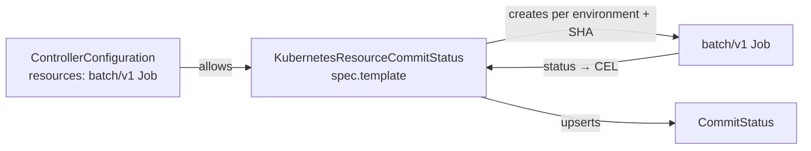

# Kubernetes Resource Commit Status

`KubernetesResourceCommitStatus` gates a promotion on a Kubernetes resource the controller creates for you: a
`batch/v1 Job` that runs a smoke test, an Argo Workflows `Workflow`, an Argo Rollouts `AnalysisRun`, or any other
namespaced kind installed in the cluster. For every environment of the referenced `PromotionStrategy` the controller
instantiates the resource from an inline **template**, then evaluates a
[CEL](https://kubernetes.io/docs/reference/using-api/cel/) expression against the live resource to compute the commit
status phase (`pending`, `success`, or `failure`). The CEL environment is the one Kubernetes uses for CRD validation
rules and admission policies, with the same extension libraries, and expressions are type-checked against the
created kind's schema.

## How it works

1. **Configure the kinds.** List the resource kinds gates may create in
   `ControllerConfiguration.spec.kubernetesResourceCommitStatus.resources`.
2. **Write the gate.** `KubernetesResourceCommitStatus` holds the template (an ordinary Kubernetes object whose
   string values may contain `${ }` expressions), declares the commit status `key`, and holds the phase expression.
3. **The controller reconciles.** Per applicable environment it renders the template, creates (or re-applies) the
   resource in the gate's namespace, evaluates the phase expression against the live object, writes a child
   `CommitStatus`, and mirrors the result in `status.environments[]`. Status changes on the resource trigger a
   reconcile immediately through a watch.



## Controller configuration

```yaml
apiVersion: promoter.argoproj.io/v1alpha1
kind: ControllerConfiguration
metadata:
  name: promoter-controller-configuration
  namespace: promoter-system
spec:
  kubernetesResourceCommitStatus:
    workQueue: { ... }
    resources:
      - group: batch
        version: v1
        kind: Job
      - group: argoproj.io
        version: v1alpha1
        kind: Workflow
      - group: ""            # core group, for example core/v1 ConfigMap
        version: v1
        kind: ConfigMap
```

| Field | Values | Description |
| --- | --- | --- |
| `resources[]` | `{group, version, kind}` | Namespaced kinds gates may create. Each entry produces one informer on the kind. Cluster-scoped kinds are rejected. |

`resources` is a **startup setting**: the ControllerConfiguration controller shuts the process down when it changes so
the informers are rebuilt on restart (single-replica installs restart automatically; HA installs need a rolling
restart, the same as [`instanceID`](../../multi-install.md)).

### RBAC

RBAC for the configured kinds cannot be generated ahead of time; grant the controller ServiceAccount
(`promoter-controller-manager` in `promoter-system`) `get`, `list`, `watch`, `create`, `patch`, and `delete` on every
listed kind:

```yaml
apiVersion: rbac.authorization.k8s.io/v1
kind: ClusterRole
metadata:
  name: promoter-kubernetesresource-jobs
rules:
  - apiGroups: ["batch"]
    resources: ["jobs"]
    verbs: ["get", "list", "watch", "create", "patch", "delete"]
---
apiVersion: rbac.authorization.k8s.io/v1
kind: ClusterRoleBinding
metadata:
  name: promoter-kubernetesresource-jobs
roleRef:
  apiGroup: rbac.authorization.k8s.io
  kind: ClusterRole
  name: promoter-kubernetesresource-jobs
subjects:
  - kind: ServiceAccount
    name: promoter-controller-manager
    namespace: promoter-system
```

> [!IMPORTANT]
> Anyone who can create a `KubernetesResourceCommitStatus` can make the controller create the configured kinds in
> that namespace with the controller's permissions. Only list kinds you are comfortable delegating this way, and
> prefer kinds whose impact is bounded to the namespace (Jobs, Workflows, AnalysisRuns).

## The gate

```yaml
apiVersion: promoter.argoproj.io/v1alpha1
kind: KubernetesResourceCommitStatus
metadata:
  name: smoke
  namespace: team-a
spec:
  promotionStrategyRef:
    name: demo
  key: smoke-test
  reportOn: proposed
  template:
    apiVersion: batch/v1
    kind: Job
    spec:
      ttlSecondsAfterFinished: 3600
      backoffLimit: 0
      suspend: ${ Branch == 'environment/production' && !has(Environment.active) }
      template:
        spec:
          restartPolicy: Never
          containers:
            - name: test
              image: ghcr.io/acme/smoke:latest
              args: ["--sha", "${ Sha }", "--env", "${ Branch }"]
              env: ${ PromotionStrategy.spec.environments.map(e, {'name': 'BRANCH_' + e.branch.replace('/', '_').upperAscii(), 'value': e.branch}) }
  lifecycle:
    mode: PerSha
    historyLimit: 1
  phase:
    expression: |
      Resource.?status.?conditions.orValue([]).exists(c, c.type == 'Complete' && c.status == 'True')
        ? {'phase': 'success'}
        : Resource.?status.?conditions.orValue([]).exists(c, c.type == 'Failed' && c.status == 'True')
          ? {'phase': 'failure', 'description': 'Smoke test is failing'}
          : {'phase': 'pending'}
  description: "Smoke test ${ ResourceName } is ${ Phase }"
```

Declare the key on the PromotionStrategy as usual:

```yaml
apiVersion: promoter.argoproj.io/v1alpha1
kind: PromotionStrategy
metadata:
  name: demo
spec:
  proposedCommitStatuses:
    - key: smoke-test
```

| Field | Description |
| --- | --- |
| `key` | Commit status key matched against `proposedCommitStatuses` / `activeCommitStatuses`. |
| `reportOn` | `proposed` (default) creates the resource for the proposed hydrated SHA and reports on it; `active` uses the active hydrated SHA. |
| `publishTo` | Copied to the child CommitStatus. Default `["scm"]`. |
| `template` | The object to create, see below. Its `apiVersion`/`kind` must be listed in the ControllerConfiguration. |
| `lifecycle.mode` | `PerSha` (default) or `InPlace`, see below. |
| `lifecycle.historyLimit` | Resources kept per environment in `PerSha` mode, including the current one (default 1). |
| `phase.expression` | CEL expression, see below. |
| `description` / `url` | Optional CommitStatus description and URL, with `${ }` expressions. |

## The template

`spec.template` is an ordinary Kubernetes object. `apiVersion` and `kind` must be literal and name a configured
kind. `metadata.name`, `metadata.namespace`, and `status` are ignored because the controller sets them;
`metadata.labels` and `metadata.annotations` are kept and merged under the controller's labels. Everything else is
copied into the created resource.

### Expressions

Any **string** value may contain [CEL](https://kubernetes.io/docs/reference/using-api/cel/) expressions wrapped in
`${ }`. Two forms exist:

- **Standalone.** A value that is exactly one expression, such as `suspend: ${ Branch == 'environment/production' }`
  or `env: ${ [...] }`, is replaced by the expression's result **with its type preserved**. This is how integers,
  booleans, lists, and whole objects are computed. A result of `null`, or an absent optional such as
  `optional.none()` or `Environment.?active.?hydrated.?sha`, removes the field (or the list item).
- **Embedded.** A string that mixes text and expressions, such as `"smoke-${ ShortSha }"`, concatenates the pieces;
  numbers and booleans are formatted as text, lists and objects as JSON, and `null` is an error (use `orValue()` for
  a default).

`$${` produces a literal `${`. Values without `${` and non-string values are copied verbatim.

Objects are addressed by their **JSON field names**, as in `kubectl` output: `Environment.proposed.hydrated.sha`,
`PromotionStrategy.spec.environments`. CEL requires both branches of a conditional to have the same type; to set a
field conditionally use optionals: `${ cond ? optional.of(value) : optional.none() }`.

| Variable | Description |
| --- | --- |
| `Branch` | Environment branch, for example `environment/development` |
| `Sha` / `ShortSha` | Reported hydrated SHA and its first 7 characters |
| `ReportOn` | `proposed` or `active` |
| `Environment` | The `PromotionStrategy.status.environments[]` entry for the branch |
| `PromotionStrategy` | The full PromotionStrategy |
| `KubernetesResourceCommitStatus` | The gate (snapshot from the previous reconcile) |

### Type checking

The Promoter variables are typed from the Promoter OpenAPI schema, and the controller resolves the created kind's
OpenAPI v3 schema through discovery. Expressions are compiled against both, so these are reported as `Ready=False`
with the expression and the template path **before anything is created**:

- a misspelled variable, or a misspelled field of a typed variable such as `Environment.propsed`;
- a standalone expression or a literal whose type does not match the field it populates, for example a string for
  `spec.parallelism` or an integer for `spec.suspend`, including the item type of a list and the value type of a
  map (`args: ${ [1, 2] }` is rejected for a list of strings);
- a literal that is not one of the field's enum values;
- an expression that can remove a field the schema requires (a `null` or an optional result);
- text with embedded expressions in a non-string field, and a list, map, or null in a label, annotation,
  `description`, or `url`.

Fields the schema does not describe (for example under `x-kubernetes-preserve-unknown-fields`, or untyped unions such
as a Tekton param `value`) are dynamically typed: they are not checked in the template, and reading them from
`Resource` compiles but is only type-checked at run time. When the kind's schema cannot be resolved at all, `Resource`
is untyped and only the API server validates the rendered object.

The library set is the Kubernetes one: `has()`, optionals (`.?`, `orValue()`, `optMap()`), list macros (`exists`,
`all`, `map`, `filter`), `quantity()`, `semver()`, `url()`, `isURL()`, `format`, IP and CIDR helpers, and the string,
math, sets, and encoders extensions.

### Validation at admission time

The gate holds the whole template, so the CRD schema cannot validate it. The controller can instead serve a
[validating admission webhook](../../advanced-usage/admission-webhook.md) that runs the same compile-time checks
when the gate is created or updated, plus a check that every template field exists in the kind's schema (the API
server would otherwise drop a misspelled field silently). A bad gate is then rejected by `kubectl apply` or shown as
a sync error by Argo CD:

```text
The KubernetesResourceCommitStatus "smoke-test" is invalid:
spec.template.spec.parallelism: Invalid value: "${ Sha }": expression "Sha" returns string but the field expects int
```

The webhook is included in the `install-with-dashboard-*` bundles. Without it, the same errors appear as
`Ready=False` on the first reconcile.

Examples:

```yaml
# A label-safe branch name
labels:
  environment: ${ Branch.replace('/', '-') }

# Only set a field in one environment
activeDeadlineSeconds: ${ Branch == 'environment/development' ? optional.of(600) : optional.none() }

# A resource request computed from a quantity
memory: ${ quantity('256Mi').add(quantity('64Mi')).asInteger() }
```

## Lifecycle modes

**`PerSha`** (default) creates a new resource for every (environment, SHA) pair and never mutates it afterwards. The
name is derived from the gate name, branch, and SHA and is bounded to 63 characters so it is valid for kinds such as Job
that copy their name into a label. Once the current SHA's resource exists, older resources for the same environment are
deleted down to `historyLimit`. Use this for immutable or run-once kinds (Job, Workflow, AnalysisRun).

A SHA that reached `success` or `failure` is **terminal**: if its resource disappears afterwards (for example a Job
removed by `ttlSecondsAfterFinished`), the gate keeps the last report and does not recreate the resource. A new SHA
always starts over with a fresh resource and `pending`.

**`InPlace`** keeps a single resource per environment and re-applies the rendered template with Server-Side Apply on
every reconcile, so SHA changes and template changes propagate into the same object. Fields set by other managers are
preserved unless the template also sets them. Use this for mutable kinds. Immutable-field changes surface as
`Ready=False` on the gate.

## Phase expression

`spec.phase.expression` runs on every reconcile while the resource exists. It sees the template variables plus:

| Variable | Description |
| --- | --- |
| `Resource` | The live resource as a map, including `status` |

Return either a boolean (`true` → `success`, `false` → `pending`) or an object `{ phase, description?, url? }` where
`phase` is `success`, `pending`, or `failure` (omitted means `pending`). Because CEL conditionals must have one type,
an expression returns booleans throughout or objects throughout. Any other value fails the reconcile, and an
expression whose type is statically neither is rejected at compile time.

> [!WARNING]
> CEL raises an error when an absent field is accessed. A freshly created Job has no `status.conditions`, so always
> guard optional paths with `.?` and `orValue()`, for example `Resource.?status.?conditions.orValue([])` or
> `Resource.?status.?succeeded.orValue(0) > 0`.

Examples:

```text
# Argo Workflows
Resource.?status.?phase.orValue('') == 'Succeeded' ? {'phase': 'success'}
  : (Resource.?status.?phase.orValue('') in ['Failed', 'Error']
      ? {'phase': 'failure', 'description': Resource.?status.?message.orValue('Workflow failed')}
      : {'phase': 'pending'})

# Argo Rollouts AnalysisRun
Resource.?status.?phase.orValue('') == 'Successful' ? {'phase': 'success'}
  : (Resource.?status.?phase.orValue('') in ['Failed', 'Error', 'Inconclusive'] ? {'phase': 'failure'} : {'phase': 'pending'})

# Job, counting pods instead of conditions
Resource.?status.?succeeded.orValue(0) > 0 ? {'phase': 'success'}
  : (Resource.?status.?failed.orValue(0) > 0 ? {'phase': 'failure'} : {'phase': 'pending'})
```

## Description and URL

`spec.description` and `spec.url` use the same `${ }` expressions as the template and see the template variables plus:

| Variable | Description |
| --- | --- |
| `Phase` | The phase computed this reconcile |
| `Resource` | The live resource as a map (nil when it does not exist) |
| `ResourceName` / `ResourceKind` | The created resource's name and Kind |
| `ExpressionDescription` / `ExpressionUrl` | The description and url returned by the phase expression, if any |

When `description` is empty, the description returned by the expression is used, falling back to
`Waiting for Job <name>`, `Job <name> reports success`, or `Job <name> reports failure`. When `url` is empty, the
`url` returned by the expression is used.

## Status

```yaml
status:
  observedGeneration: 2
  conditions:
    - type: Ready
      status: "True"
  environments:
    - branch: environment/development
      phase: success
      description: Smoke test smoke-environment-development-01234567-9f3e2a1b is success
      reportedSha: 0123456789abcdef0123456789abcdef01234567
      resource:
        apiVersion: batch/v1
        kind: Job
        name: smoke-environment-development-01234567-9f3e2a1b
      lastEvaluationTime: "2026-10-31T01:00:00Z"
```

`Ready=False` reports configuration problems: a template without `apiVersion`/`kind`, a kind that is not listed in the
ControllerConfiguration, an expression that does not compile or type-check, a rendered object the API server rejects,
an invalid phase expression result, or missing RBAC on the kind (the API server's `forbidden` error names the verb).

Created resources carry these labels, which also drive pruning:

| Label | Value |
| --- | --- |
| `promoter.argoproj.io/kubernetes-resource-commit-status` | gate name |
| `promoter.argoproj.io/environment` | label-safe branch |
| `promoter.argoproj.io/commit-status` | `spec.key` |
| `promoter.argoproj.io/sha` | reported SHA |
| `promoter.argoproj.io/instance-id` | the install's instance ID in [multi-install](../../multi-install.md) mode |

They also carry the annotation `promoter.argoproj.io/created-at` (RFC 3339 with nanoseconds), which `historyLimit`
pruning orders by because `metadata.creationTimestamp` only has second granularity.

The gate is the controller owner of every resource it creates and of its CommitStatuses, so deleting the gate garbage
collects them.

## Multiple controller installs

Created resources are stamped with the `promoter.argoproj.io/instance-id` label automatically when the controller runs
with one; no extra labeling is needed.

## Events

| Event Type | Event Reason | Description |
| --- | --- | --- |
| Normal | KubernetesResourceCreated | The resource was created for an environment and SHA. |
| Normal | KubernetesResourcePruned | A created resource was deleted because it exceeded `historyLimit` or its environment is no longer gated. |
| Normal/Warning | CommitStatusPhaseChanged | The phase for an environment changed. Warning when the new phase is `failure`. |
| Warning | CommitStatusesNotReady | A managed CommitStatus is not Ready. |
| Normal | OrphanedCommitStatusDeleted | A CommitStatus for a removed environment was deleted. |

## Field reference

See the [CRD specification](../../crd-specs.md#kubernetesresourcecommitstatus) and `kubectl explain
kubernetesresourcecommitstatus.spec`.
