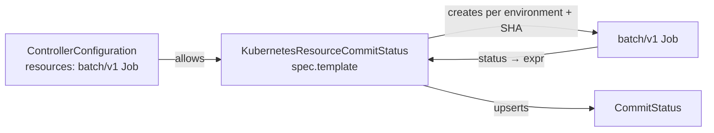

# Kubernetes Resource Commit Status

`KubernetesResourceCommitStatus` gates a promotion on a Kubernetes resource the controller creates for you: a
`batch/v1 Job` that runs a smoke test, an Argo Workflows `Workflow`, an Argo Rollouts `AnalysisRun`, or any other
namespaced kind installed in the cluster. For every environment of the referenced `PromotionStrategy` the controller
instantiates the resource from an inline **template**, then evaluates an [expr](https://expr-lang.org) expression
against the live resource to compute the commit status phase (`pending`, `success`, or `failure`).

## How it works

1. **Configure the kinds.** List the resource kinds gates may create in
   `ControllerConfiguration.spec.kubernetesResourceCommitStatus.resources`.
2. **Write the gate.** `KubernetesResourceCommitStatus` holds the template (an ordinary Kubernetes object whose
   string values may contain `${ }` expressions), declares the commit status `key`, and holds the phase expression.
3. **The controller reconciles.** Per applicable environment it renders the template, creates (or re-applies) the
   resource in the gate's namespace, evaluates the phase expression against the live object, writes a child
   `CommitStatus`, and mirrors the result in `status.environments[]`. Status changes on the resource trigger a
   reconcile immediately through a watch.



## Controller configuration

```yaml
apiVersion: promoter.argoproj.io/v1alpha1
kind: ControllerConfiguration
metadata:
  name: promoter-controller-configuration
  namespace: promoter-system
spec:
  kubernetesResourceCommitStatus:
    workQueue: { ... }
    resources:
      - group: batch
        version: v1
        kind: Job
      - group: argoproj.io
        version: v1alpha1
        kind: Workflow
      - group: ""            # core group, for example core/v1 ConfigMap
        version: v1
        kind: ConfigMap
```

| Field | Values | Description |
| --- | --- | --- |
| `resources[]` | `{group, version, kind}` | Namespaced kinds gates may create. Each entry produces one informer on the kind. Cluster-scoped kinds are rejected. |

`resources` is a **startup setting**: the ControllerConfiguration controller shuts the process down when it changes so
the informers are rebuilt on restart (single-replica installs restart automatically; HA installs need a rolling
restart, the same as [`instanceID`](../../multi-install.md)).

### RBAC

RBAC for the configured kinds cannot be generated ahead of time; grant the controller ServiceAccount
(`promoter-controller-manager` in `promoter-system`) `get`, `list`, `watch`, `create`, `patch`, and `delete` on every
listed kind:

```yaml
apiVersion: rbac.authorization.k8s.io/v1
kind: ClusterRole
metadata:
  name: promoter-kubernetesresource-jobs
rules:
  - apiGroups: ["batch"]
    resources: ["jobs"]
    verbs: ["get", "list", "watch", "create", "patch", "delete"]
---
apiVersion: rbac.authorization.k8s.io/v1
kind: ClusterRoleBinding
metadata:
  name: promoter-kubernetesresource-jobs
roleRef:
  apiGroup: rbac.authorization.k8s.io
  kind: ClusterRole
  name: promoter-kubernetesresource-jobs
subjects:
  - kind: ServiceAccount
    name: promoter-controller-manager
    namespace: promoter-system
```

> [!IMPORTANT]
> Anyone who can create a `KubernetesResourceCommitStatus` can make the controller create the configured kinds in
> that namespace with the controller's permissions. Only list kinds you are comfortable delegating this way, and
> prefer kinds whose impact is bounded to the namespace (Jobs, Workflows, AnalysisRuns).

## The gate

```yaml
apiVersion: promoter.argoproj.io/v1alpha1
kind: KubernetesResourceCommitStatus
metadata:
  name: smoke
  namespace: team-a
spec:
  promotionStrategyRef:
    name: demo
  key: smoke-test
  reportOn: proposed
  template:
    apiVersion: batch/v1
    kind: Job
    spec:
      ttlSecondsAfterFinished: 3600
      backoffLimit: 0
      suspend: ${ Branch == 'environment/production' && Environment.Active.Hydrated.Sha == '' }
      template:
        spec:
          restartPolicy: Never
          containers:
            - name: test
              image: ghcr.io/acme/smoke:latest
              args: ["--sha", "${ Sha }", "--env", "${ Branch }"]
              env: ${ PromotionStrategy.Spec.Environments | map({name: 'ENV_' + string(#index), value: .Branch}) }
  lifecycle:
    mode: PerSha
    historyLimit: 1
  phase:
    expression: |
      any(Resource.status?.conditions ?? [], {.type == 'Complete' && .status == 'True'})
        ? {phase: 'success'}
        : any(Resource.status?.conditions ?? [], {.type == 'Failed' && .status == 'True'})
          ? {phase: 'failure', description: 'Smoke test is failing'}
          : false
  description: "Smoke test ${ ResourceName } is ${ Phase }"
```

Declare the key on the PromotionStrategy as usual:

```yaml
apiVersion: promoter.argoproj.io/v1alpha1
kind: PromotionStrategy
metadata:
  name: demo
spec:
  proposedCommitStatuses:
    - key: smoke-test
```

| Field | Description |
| --- | --- |
| `key` | Commit status key matched against `proposedCommitStatuses` / `activeCommitStatuses`. |
| `reportOn` | `proposed` (default) creates the resource for the proposed hydrated SHA and reports on it; `active` uses the active hydrated SHA. |
| `publishTo` | Copied to the child CommitStatus. Default `["scm"]`. |
| `template` | The object to create, see below. Its `apiVersion`/`kind` must be listed in the ControllerConfiguration. |
| `lifecycle.mode` | `PerSha` (default) or `InPlace`, see below. |
| `lifecycle.historyLimit` | Resources kept per environment in `PerSha` mode, including the current one (default 1). |
| `lifecycle.pruneOnSuccess` | `PerSha` only. Delete the resource as soon as the phase becomes `success`; the gate keeps reporting success. |
| `lifecycle.retryOnDelete` | `PerSha` only. Deleting the resource of a failed SHA creates a new one and the phase returns to `pending`. |
| `phase.expression` | expr expression, see below. |
| `description` / `url` | Optional CommitStatus description and URL, with `${ }` expressions. |

## The template

`spec.template` is an ordinary Kubernetes object. `apiVersion` and `kind` must be literal and name a configured
kind. `metadata.name`, `metadata.namespace`, and `status` are ignored because the controller sets them;
`metadata.labels` and `metadata.annotations` are kept and merged under the controller's labels. Everything else is
copied into the created resource.

### Expressions

Any **string** value may contain [expr](https://expr-lang.org) expressions wrapped in `${ }`. Two forms exist:

- **Standalone.** A value that is exactly one expression, such as `suspend: ${ Branch == 'environment/production' }`
  or `env: ${ [...] }`, is replaced by the expression's result **with its type preserved**. This is how integers,
  booleans, lists, and whole objects are computed. A result of `nil` removes the field (or the list item).
- **Embedded.** A string that mixes text and expressions, such as `"smoke-${ ShortSha }"`, concatenates the pieces;
  numbers and booleans are formatted as text, lists and objects as JSON, and `nil` is an error (use `??` for a
  default).

`$${` produces a literal `${`. Values without `${` and non-string values are copied verbatim.

| Variable | Description |
| --- | --- |
| `Branch` | Environment branch, for example `environment/development` |
| `Sha` / `ShortSha` | Reported hydrated SHA and its first 7 characters |
| `ReportOn` | `proposed` or `active` |
| `Environment` | The `PromotionStrategy.status.environments[]` entry for the branch |
| `PromotionStrategy` | The full PromotionStrategy |
| `KubernetesResourceCommitStatus` | The gate (snapshot from the previous reconcile) |

Expressions are compiled against this variable set, so a misspelled variable, or a misspelled field of a typed
variable such as `Environment.Propsed`, fails the reconcile with a compile error that names the expression and the
path in the template. The rendered object is validated by the API server when it is created, so an expression that
produces the wrong type for a field (for example a string for `parallelism`) surfaces as `Ready=False` with the API
server's message.

> [!NOTE]
> The gate holds the whole template, so the CRD schema cannot validate the template against the target kind at
> admission time. Typos in field names are caught when the resource is created, one reconcile later.

Examples:

```yaml
# A label-safe branch name
labels:
  environment: ${ Branch | replace('/', '-') }

# Only set a field in one environment
activeDeadlineSeconds: ${ Branch == 'environment/development' ? 600 : nil }

# Pass the whole environment status as JSON
args: ["--environment", "${ toJSON(Environment) }"]
```

## Lifecycle modes

**`PerSha`** (default) creates a new resource for every (environment, SHA) pair and never mutates it afterwards. The
name is derived from the gate name, branch, and SHA and is bounded to 63 characters so it is valid for kinds such as Job
that copy their name into a label. Once the current SHA's resource exists, older resources for the same environment are
deleted down to `historyLimit`. Use this for immutable or run-once kinds (Job, Workflow, AnalysisRun).

A SHA that reached `success` or `failure` is **terminal**: if its resource disappears afterwards (for example a Job
removed by `ttlSecondsAfterFinished`), the gate keeps the last report and does not recreate the resource. A new SHA
always starts over with a fresh resource and `pending`. Two options adjust this:

- `pruneOnSuccess: true` deletes the resource as soon as the phase becomes `success`. Success stays terminal, so the
  report is kept and nothing is recreated. Use it when successful runs are not worth keeping around.
- `retryOnDelete: true` makes failure non-terminal: deleting the resource of a failed SHA makes the controller create a
  new one and the phase returns to `pending`, so deleting the resource is how you rerun a failed check. Leave it off
  for kinds that remove failed resources on their own, such as a Job with `ttlSecondsAfterFinished`, or every removal
  starts another run.

**`InPlace`** keeps a single resource per environment and re-applies the rendered template with Server-Side Apply on
every reconcile, so SHA changes and template changes propagate into the same object. Fields set by other managers are
preserved unless the template also sets them. Use this for mutable kinds. Immutable-field changes surface as
`Ready=False` on the gate.

## Phase expression

`spec.phase.expression` runs on every reconcile while the resource exists. It sees the template variables plus:

| Variable | Description |
| --- | --- |
| `Resource` | The live resource as a map, including `status` |
| `keyBy(list, keyField, valueField)` | Turns a list of objects into a map, for name/value lists such as Tekton results or container env. An empty `valueField` keeps the whole item. |

Return either a boolean (`true` → `success`, `false` → `pending`) or an object `{ phase, description?, url? }` where
`phase` is `success`, `pending`, or `failure` (omitted means `pending`). Any other value fails the reconcile.

> [!WARNING]
> expr raises an error when a member is accessed through a missing (`nil`) value. A freshly created Job has no
> `status.conditions`, so always guard optional paths with `?.` and `??`, for example
> `Resource.status?.conditions ?? []` or `(Resource.status?.succeeded ?? 0) > 0`.

Examples:

```text
# Argo Workflows
Resource.status?.phase == 'Succeeded' ? true
  : (Resource.status?.phase in ['Failed', 'Error'] ? {phase: 'failure', description: Resource.status?.message ?? 'Workflow failed'} : false)

# Argo Rollouts AnalysisRun
Resource.status?.phase == 'Successful' ? {phase: 'success'}
  : (Resource.status?.phase in ['Failed', 'Error', 'Inconclusive'] ? {phase: 'failure'} : false)

# Job, counting pods instead of conditions
(Resource.status?.succeeded ?? 0) > 0 ? true : ((Resource.status?.failed ?? 0) > 0 ? {phase: 'failure'} : false)
```

## Example: a Tekton Pipeline

Tekton `PipelineRun` and `TaskRun` are ordinary kinds, so gating on a Pipeline needs no Tekton-specific support. List
`tekton.dev/v1 PipelineRun` in the ControllerConfiguration, grant the controller RBAC on `pipelineruns`, and write the
run you would write by hand, with the SHA and branch as parameters. Tekton results are a name/value list on
`status.results`; `keyBy` turns them into a map.

```yaml
apiVersion: promoter.argoproj.io/v1alpha1
kind: KubernetesResourceCommitStatus
metadata:
  name: security-scan
spec:
  promotionStrategyRef:
    name: demo
  key: security-scan
  reportOn: proposed
  template:
    apiVersion: tekton.dev/v1
    kind: PipelineRun
    spec:
      pipelineRef:
        name: security-scan
      taskRunTemplate:
        serviceAccountName: tekton-runner
      params:
        - name: gitUrl
          value: "https://github.com/myorg/myrepo/commit/${ Sha }"
        - name: branch
          value: ${ Branch }
        - name: endpoints
          value: ["api/health", "api/users"]
  lifecycle:
    pruneOnSuccess: true
    retryOnDelete: true
  phase:
    expression: |
      let conditions = Resource.status?.conditions ?? [];
      let results = keyBy(Resource.status?.results ?? [], 'name', 'value');
      any(conditions, .type == 'Succeeded' && .status == 'False')
        ? {phase: 'failure', description: find(conditions, .type == 'Succeeded').message}
        : !any(conditions, .type == 'Succeeded' && .status == 'True') ? false
        : !('vulnerabilities' in results) ? {phase: 'failure', description: 'Result vulnerabilities is missing'}
        : results.vulnerabilities == '0' ? {phase: 'success'}
        : {phase: 'failure', description: results.vulnerabilities + ' vulnerabilities found'}
```

Setting `reportOn: proposed` runs the pipeline against the proposed commit and gates it; `reportOn: active` runs it
against what is live and gates the environments after it. To run against the active commit while gating the proposed
one, keep `reportOn: proposed` and pass `${ Environment.Active.Hydrated.Sha }` as the parameter.

## Description and URL

`spec.description` and `spec.url` use the same `${ }` expressions as the template and see the template variables plus:

| Variable | Description |
| --- | --- |
| `Phase` | The phase computed this reconcile |
| `Resource` | The live resource as a map (nil when it does not exist) |
| `ResourceName` / `ResourceKind` | The created resource's name and Kind |
| `ExpressionDescription` / `ExpressionUrl` | The description and url returned by the phase expression, if any |

When `description` is empty, the description returned by the expression is used, falling back to
`Waiting for Job <name>`, `Job <name> reports success`, or `Job <name> reports failure`. When `url` is empty, the
`url` returned by the expression is used.

## Status

```yaml
status:
  observedGeneration: 2
  conditions:
    - type: Ready
      status: "True"
  environments:
    - branch: environment/development
      phase: success
      description: Smoke test smoke-environment-development-01234567-9f3e2a1b is success
      reportedSha: 0123456789abcdef0123456789abcdef01234567
      resource:
        apiVersion: batch/v1
        kind: Job
        name: smoke-environment-development-01234567-9f3e2a1b
      lastEvaluationTime: "2026-10-31T01:00:00Z"
```

`Ready=False` reports configuration problems: a template without `apiVersion`/`kind`, a kind that is not listed in the
ControllerConfiguration, an expression that does not compile or produces a value the API server rejects, an invalid
phase expression result, or missing RBAC on the kind (the API server's `forbidden` error names the verb).

Created resources carry these labels, which also drive pruning:

| Label | Value |
| --- | --- |
| `promoter.argoproj.io/kubernetes-resource-commit-status` | gate name |
| `promoter.argoproj.io/environment` | label-safe branch |
| `promoter.argoproj.io/commit-status` | `spec.key` |
| `promoter.argoproj.io/sha` | reported SHA |
| `promoter.argoproj.io/instance-id` | the install's instance ID in [multi-install](../../multi-install.md) mode |

They also carry the annotation `promoter.argoproj.io/created-at` (RFC 3339 with nanoseconds), which `historyLimit`
pruning orders by because `metadata.creationTimestamp` only has second granularity.

The gate is the controller owner of every resource it creates and of its CommitStatuses, so deleting the gate garbage
collects them.

## Multiple controller installs

Created resources are stamped with the `promoter.argoproj.io/instance-id` label automatically when the controller runs
with one; no extra labeling is needed.

## Events

| Event Type | Event Reason | Description |
| --- | --- | --- |
| Normal | KubernetesResourceCreated | The resource was created for an environment and SHA. |
| Normal | KubernetesResourcePruned | A created resource was deleted because it exceeded `historyLimit` or its environment is no longer gated. |
| Normal/Warning | CommitStatusPhaseChanged | The phase for an environment changed. Warning when the new phase is `failure`. |
| Warning | CommitStatusesNotReady | A managed CommitStatus is not Ready. |
| Normal | OrphanedCommitStatusDeleted | A CommitStatus for a removed environment was deleted. |

## Field reference

See the [CRD specification](../../crd-specs.md#kubernetesresourcecommitstatus) and `kubectl explain
kubernetesresourcecommitstatus.spec`.
