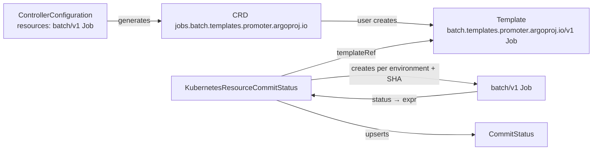

# Kubernetes Resource Commit Status

`KubernetesResourceCommitStatus` gates a promotion on a Kubernetes resource the controller creates for you: a
`batch/v1 Job` that runs a smoke test, an Argo Workflows `Workflow`, an Argo Rollouts `AnalysisRun`, or any other
namespaced kind installed in the cluster. For every environment of the referenced `PromotionStrategy` the controller
instantiates the real resource from a **template**, then evaluates an [expr](https://expr-lang.org) expression against
the live resource to compute the commit status phase (`pending`, `success`, or `failure`).

## How it works

1. **Configure the kinds.** List the resource kinds gates may create in
   `ControllerConfiguration.spec.kubernetesResourceCommitStatus.resources`.
2. **Wrapped template CRDs are generated.** At startup the controller generates one CustomResourceDefinition per
   configured kind in the API group `<group>.templates.promoter.argoproj.io` (`core.templates.promoter.argoproj.io` for
   the core group). The Kind, version, and schema match the source kind, so `batch/v1 Job` becomes
   `batch.templates.promoter.argoproj.io/v1 Job`. Because the group differs, the real controller (here the Job
   controller) never reconciles these objects: they are inert templates with schema validation.
3. **Write a template.** Create an instance of the wrapped kind. String values may contain Go templates such as
   `{{ .Sha }}` and `{{ .Branch }}`.
4. **Create the gate.** `KubernetesResourceCommitStatus` references the template, declares the commit status `key`, and
   holds the phase expression.
5. **The controller reconciles.** Per applicable environment it creates (or re-applies) the real resource in the gate's
   namespace, evaluates the expression against the live object, writes a child `CommitStatus`, and mirrors the result in
   `status.environments[]`. Status changes on the real resource trigger a reconcile immediately through a watch.



## Controller configuration

```yaml
apiVersion: promoter.argoproj.io/v1alpha1
kind: ControllerConfiguration
metadata:
  name: promoter-controller-configuration
  namespace: promoter-system
spec:
  kubernetesResourceCommitStatus:
    workQueue: { ... }
    resources:
      - group: batch
        version: v1
        kind: Job
      - group: argoproj.io
        version: v1alpha1
        kind: Workflow
      - group: ""            # core group, for example core/v1 ConfigMap
        version: v1
        kind: ConfigMap
    templateCRDs: Enabled    # Disabled when the controller may not create CRDs
```

| Field | Values | Description |
| --- | --- | --- |
| `resources[]` | `{group, version, kind}` | Namespaced kinds gates may create. Each entry produces one wrapped template CRD and one informer on the real kind. Cluster-scoped kinds are rejected. |
| `templateCRDs` | `Enabled` (default), `Disabled` | Whether the controller generates the wrapped template CRDs at startup. The namespaced install sets `Disabled` because a `Role` cannot create cluster-scoped CRDs; the wrapped CRDs must then be provided by other means. |

Both fields are **startup settings**. The ControllerConfiguration controller shuts the process down when `resources`
changes so the informers and CRDs are rebuilt on restart (single-replica installs restart automatically; HA installs need
a rolling restart, the same as [`instanceID`](../../multi-install.md)).

Listing several versions of the same group and kind produces one CRD with several served versions; the first listed
version is the storage version. Removing a kind never deletes its wrapped CRD (that would delete user templates); remove
it by hand:

```bash
kubectl get crd -l promoter.argoproj.io/template-crd=true
kubectl delete crd jobs.batch.templates.promoter.argoproj.io
```

### Schema of the wrapped kinds

For CRD-backed kinds the schema is copied from the source CRD. For built-in kinds it is read from the API server's
`/openapi/v3` document and converted into a structural CRD schema: `status` is removed, defaults and descriptions are
dropped, `IntOrString` and `Quantity` become `x-kubernetes-int-or-string`, and recursive types collapse to
`x-kubernetes-preserve-unknown-fields`. If the API server still rejects the converted schema, the controller falls back
to a permissive schema (`spec` accepts anything) and logs the reason, so the kind remains usable without validation.

### RBAC

The shipped ClusterRole grants `customresourcedefinitions` `get`, `list`, `watch`, `create`, and `update` for CRD
generation. RBAC for the configured kinds cannot be generated ahead of time; grant the controller ServiceAccount
(`promoter-controller-manager` in `promoter-system`) these verbs for every listed kind:

| Resource | Verbs | Why |
| --- | --- | --- |
| the real kind (`batch` / `jobs`) | `get`, `list`, `watch`, `create`, `patch`, `delete` | create, watch, re-apply (InPlace), and prune resources |
| the template kind (`batch.templates.promoter.argoproj.io` / `jobs`) | `get`, `list`, `watch` | read templates and reconcile on template changes |

```yaml
apiVersion: rbac.authorization.k8s.io/v1
kind: ClusterRole
metadata:
  name: promoter-kubernetesresource-jobs
rules:
  - apiGroups: ["batch"]
    resources: ["jobs"]
    verbs: ["get", "list", "watch", "create", "patch", "delete"]
  - apiGroups: ["batch.templates.promoter.argoproj.io"]
    resources: ["jobs"]
    verbs: ["get", "list", "watch"]
---
apiVersion: rbac.authorization.k8s.io/v1
kind: ClusterRoleBinding
metadata:
  name: promoter-kubernetesresource-jobs
roleRef:
  apiGroup: rbac.authorization.k8s.io
  kind: ClusterRole
  name: promoter-kubernetesresource-jobs
subjects:
  - kind: ServiceAccount
    name: promoter-controller-manager
    namespace: promoter-system
```

Users who write templates need `create`/`update` on the template kind. Because the wrapped API group is derived from
the source group, a single rule cannot cover every template kind; add one rule per configured group.

> [!IMPORTANT]
> Anyone who can create a `KubernetesResourceCommitStatus` and a template can make the controller create the configured
> kinds in that namespace with the controller's permissions. Only list kinds you are comfortable delegating this way, and
> prefer kinds whose impact is bounded to the namespace (Jobs, Workflows, AnalysisRuns).

## Templates

A template is an ordinary object of the wrapped kind. Its body (everything except `apiVersion`, `kind`, `metadata`, and
`status`) is copied into the real resource. `metadata.labels` and `metadata.annotations` from the template are preserved
and merged under the controller's labels.

```yaml
apiVersion: batch.templates.promoter.argoproj.io/v1
kind: Job
metadata:
  name: smoke-test
  namespace: team-a
spec:
  ttlSecondsAfterFinished: 3600
  backoffLimit: 0
  template:
    spec:
      restartPolicy: Never
      containers:
        - name: test
          image: ghcr.io/acme/smoke:latest
          args: ["--sha", "{{ .Sha }}", "--env", "{{ .Branch }}"]
```

### Template variables

Every **string** value in the template that contains `{{` is rendered as a Go template with
[Sprig](https://masterminds.github.io/sprig/) functions (`env`, `expandenv`, and `getHostByName` are removed;
`urlQueryEscape` is added). Values without `{{` and non-string values are copied verbatim, so only string fields can be
parameterized. Unknown variables fail the reconcile (`missingkey=error`).

| Variable | Description |
| --- | --- |
| `.Branch` | Environment branch, for example `environment/development` |
| `.Sha` / `.ShortSha` | Reported hydrated SHA and its first 7 characters |
| `.ReportOn` | `proposed` or `active` |
| `.Environment` | The `PromotionStrategy.status.environments[]` entry for the branch |
| `.PromotionStrategy` | The full PromotionStrategy |
| `.KubernetesResourceCommitStatus` | The gate (snapshot from the previous reconcile) |
| `.Template` | The template object as a map |

Example: a label-safe branch name with Sprig: `{{ .Branch | replace "/" "-" }}`.

## The gate

```yaml
apiVersion: promoter.argoproj.io/v1alpha1
kind: KubernetesResourceCommitStatus
metadata:
  name: smoke
  namespace: team-a
spec:
  promotionStrategyRef:
    name: demo
  key: smoke-test
  reportOn: proposed
  templateRef:
    apiVersion: batch.templates.promoter.argoproj.io/v1
    kind: Job
    name: smoke-test
  lifecycle:
    mode: PerSha
    historyLimit: 1
  phase:
    expression: |
      any(Resource.status?.conditions ?? [], {.type == 'Complete' && .status == 'True'})
        ? {phase: 'success'}
        : any(Resource.status?.conditions ?? [], {.type == 'Failed' && .status == 'True'})
          ? {phase: 'failure', description: 'Smoke test is failing'}
          : false
  descriptionTemplate: "Smoke test {{ .ResourceName }} is {{ .Phase }}"
```

Declare the key on the PromotionStrategy as usual:

```yaml
apiVersion: promoter.argoproj.io/v1alpha1
kind: PromotionStrategy
metadata:
  name: demo
spec:
  proposedCommitStatuses:
    - key: smoke-test
```

| Field | Description |
| --- | --- |
| `key` | Commit status key matched against `proposedCommitStatuses` / `activeCommitStatuses`. |
| `reportOn` | `proposed` (default) creates the resource for the proposed hydrated SHA and reports on it; `active` uses the active hydrated SHA. |
| `publishTo` | Copied to the child CommitStatus. Default `["scm"]`. |
| `templateRef` | `apiVersion`, `kind`, `name` of the template in the gate's namespace. The `apiVersion` must be a wrapped template group. |
| `lifecycle.mode` | `PerSha` (default) or `InPlace`, see below. |
| `lifecycle.historyLimit` | Resources kept per environment in `PerSha` mode, including the current one (default 1). |
| `phase.expression` | expr expression, see below. |
| `descriptionTemplate` / `urlTemplate` | Optional Go templates for the CommitStatus description and URL. |

### Lifecycle modes

**`PerSha`** (default) creates a new resource for every (environment, SHA) pair and never mutates it afterwards. The
name is derived from the gate name, branch, and SHA and is bounded to 63 characters so it is valid for kinds such as Job
that copy their name into a label. Once the current SHA's resource exists, older resources for the same environment are
deleted down to `historyLimit`. Use this for immutable or run-once kinds (Job, Workflow, AnalysisRun).

A SHA that reached `success` or `failure` is **terminal**: if its resource disappears afterwards (for example a Job
removed by `ttlSecondsAfterFinished`), the gate keeps the last report and does not recreate the resource. A new SHA
always starts over with a fresh resource and `pending`.

**`InPlace`** keeps a single resource per environment and re-applies the rendered template with Server-Side Apply on
every reconcile, so SHA changes and template changes propagate into the same object. Fields set by other managers are
preserved unless the template also sets them. Use this for mutable kinds. Immutable-field changes surface as
`Ready=False` on the gate.

### Phase expression

`spec.phase.expression` runs on every reconcile while the resource exists. Variables:

| Variable | Description |
| --- | --- |
| `Resource` | The live resource as a map, including `status` |
| `Branch`, `Sha`, `ReportOn` | As in the template variables |
| `Environment` | `PromotionStrategy.status.environments[]` entry for the branch |
| `PromotionStrategy` | The full PromotionStrategy |
| `KubernetesResourceCommitStatus` | The gate (snapshot from the previous reconcile) |
| `Template` | The template object as a map |

Return either a boolean (`true` → `success`, `false` → `pending`) or an object `{ phase, description?, url? }` where
`phase` is `success`, `pending`, or `failure` (omitted means `pending`). Any other value fails the reconcile.

> [!WARNING]
> expr raises an error when a member is accessed through a missing (`nil`) value. A freshly created Job has no
> `status.conditions`, so always guard optional paths with `?.` and `??`, for example
> `Resource.status?.conditions ?? []` or `(Resource.status?.succeeded ?? 0) > 0`.

Examples:

```text
# Argo Workflows
Resource.status?.phase == 'Succeeded' ? true
  : (Resource.status?.phase in ['Failed', 'Error'] ? {phase: 'failure', description: Resource.status?.message ?? 'Workflow failed'} : false)

# Argo Rollouts AnalysisRun
Resource.status?.phase == 'Successful' ? {phase: 'success'}
  : (Resource.status?.phase in ['Failed', 'Error', 'Inconclusive'] ? {phase: 'failure'} : false)

# Job, counting pods instead of conditions
(Resource.status?.succeeded ?? 0) > 0 ? true : ((Resource.status?.failed ?? 0) > 0 ? {phase: 'failure'} : false)
```

### Description and URL

When `descriptionTemplate` is empty, the description returned by the expression is used, falling back to
`Waiting for Job <name>`, `Job <name> reports success`, or `Job <name> reports failure`. `descriptionTemplate` and
`urlTemplate` receive the template variables above plus `.Phase`, `.ResourceName`, `.ResourceKind`, `.Resource`, and
`.ExpressionDescription`. When `urlTemplate` is empty, the `url` returned by the expression is used.

## Status

```yaml
status:
  observedGeneration: 2
  conditions:
    - type: Ready
      status: "True"
  environments:
    - branch: environment/development
      phase: success
      description: Smoke test smoke-environment-development-01234567-9f3e2a1b is success
      reportedSha: 0123456789abcdef0123456789abcdef01234567
      resource:
        apiVersion: batch/v1
        kind: Job
        name: smoke-environment-development-01234567-9f3e2a1b
      lastEvaluationTime: "2026-10-31T01:00:00Z"
```

`Ready=False` reports configuration problems: a missing template, a template kind that is not listed in the
ControllerConfiguration, a wrapped CRD that has not been generated yet, an invalid expression result, or missing RBAC
on the real kind (the API server's `forbidden` error names the verb).

Created resources carry these labels, which also drive pruning:

| Label | Value |
| --- | --- |
| `promoter.argoproj.io/kubernetes-resource-commit-status` | gate name |
| `promoter.argoproj.io/environment` | label-safe branch |
| `promoter.argoproj.io/commit-status` | `spec.key` |
| `promoter.argoproj.io/sha` | reported SHA |
| `promoter.argoproj.io/instance-id` | the install's instance ID in [multi-install](../../multi-install.md) mode |

They also carry the annotation `promoter.argoproj.io/created-at` (RFC 3339 with nanoseconds), which `historyLimit`
pruning orders by because `metadata.creationTimestamp` only has second granularity.

The gate is the controller owner of every resource it creates and of its CommitStatuses, so deleting the gate garbage
collects them.

## Multiple controller installs

Templates are read through the instance-id partitioned cache like every other Promoter CR. In multi-install mode label
templates with `promoter.argoproj.io/instance-id: <value>`; in the default install leave the label off. Created
resources are stamped with the label automatically.

## Events

| Event Type | Event Reason | Description |
| --- | --- | --- |
| Normal | KubernetesResourceCreated | The real resource was created for an environment and SHA. |
| Normal | KubernetesResourcePruned | A created resource was deleted because it exceeded `historyLimit` or its environment is no longer gated. |
| Normal/Warning | CommitStatusPhaseChanged | The phase for an environment changed. Warning when the new phase is `failure`. |
| Warning | CommitStatusesNotReady | A managed CommitStatus is not Ready. |
| Normal | OrphanedCommitStatusDeleted | A CommitStatus for a removed environment was deleted. |

## Field reference

See the [CRD specification](../../crd-specs.md#kubernetesresourcecommitstatus) and `kubectl explain
kubernetesresourcecommitstatus.spec`.
